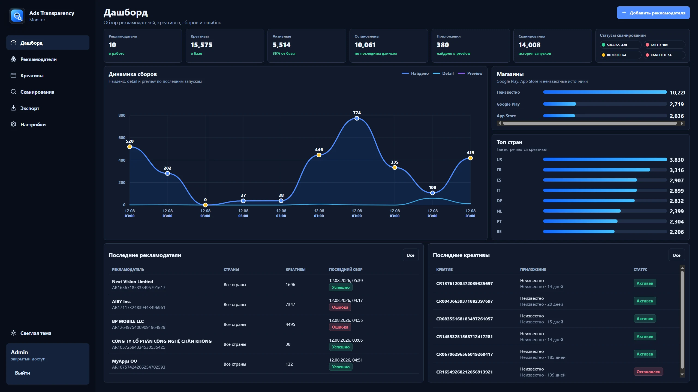

# Ads Transparency Monitor

Система мониторинга рекламных креативов Google Ads Transparency Center. Собирает объявления выбранных рекламодателей, сохраняет историю и помогает находить изменения, сравнивать креативы и выгружать результаты.



## Возможности

- Очередь сканирований, расписание, ограничение параллельных задач и повторные попытки.
- Карточки рекламодателей и объявлений, фильтры по странам, форматам, датам и приложениям.
- История сканирований, диагностика неполных данных и повторная обработка креативов.
- Выгрузка таблиц в Excel и CSV с защитой от формул в пользовательских значениях.
- MCP-сервер для поиска и анализа данных внешними клиентами; уровни доступа для чтения, изменения и администрирования.
- Авторизация в панели и хранение хешей токенов вместо открытых значений.

## Устройство проекта

| Каталог | Ответственность |
| --- | --- |
| `apps/web` | Next.js, интерфейс и HTTP API |
| `apps/worker` | Очередь заданий, расписание и браузерный сбор |
| `apps/worker/src/browser-native` | Извлечение данных страницы, нормализация и политика выполнения |
| `apps/mcp` | MCP-транспорт и инструменты, разделённые по предметным задачам |
| `packages/core` | Разбор ответов и общие модели данных |
| `packages/db` | Prisma, PostgreSQL, репозитории и миграции |
| `chrome-extension` | Вспомогательное расширение для ручного сбора |

Стек: TypeScript, Next.js, React, PostgreSQL, Prisma, Playwright и MCP SDK. Для разработки нужен Node.js 24 и PostgreSQL 17. Для контейнерного запуска нужен Docker Compose.

## Запуск

Скопируйте `.env.example` в `.env` и задайте собственные пароли, `AUTH_SECRET` и реквизиты администратора. `DATABASE_URL` в шаблоне использует имя контейнера `postgres`.

```sh
docker compose up --build postgres web
```

Панель откроется на `http://localhost:3100`. Для запуска реального сбора отдельно включите worker:

```sh
docker compose up --build worker
```

Для разработки вне контейнера замените `postgres` в `DATABASE_URL` на `localhost`, запустите PostgreSQL и выполните:

```sh
npm ci
npm run prisma:generate
npm run prisma:migrate:deploy
npm run dev
```

Worker и MCP запускаются отдельными командами `npm run dev:worker` и `npm run dev:mcp`. MCP по умолчанию слушает локальный порт 3101; для production обязателен `MCP_BEARER_TOKEN`. Параметры подключения находятся в `apps/mcp/src/env.ts`.

## Проверки

```sh
npm ci
npm run prisma:generate
npm run test:unit
npm run typecheck
npm run typecheck:qa
npm run lint
npm run build
```

Интеграционные и браузерные тесты используют отдельную тестовую БД `ads_monitor_verify` на порту 55433. Они запускаются командами `npm run test:integration` и `npm run test:e2e` при работающем Docker.

Рабочие браузерные профили, секреты и реальные сетевые дампы в репозиторий не включены. Сбор зависит от доступности Google и изменений структуры его страниц. Зелёные локальные проверки не гарантируют доступность внешнего источника.
